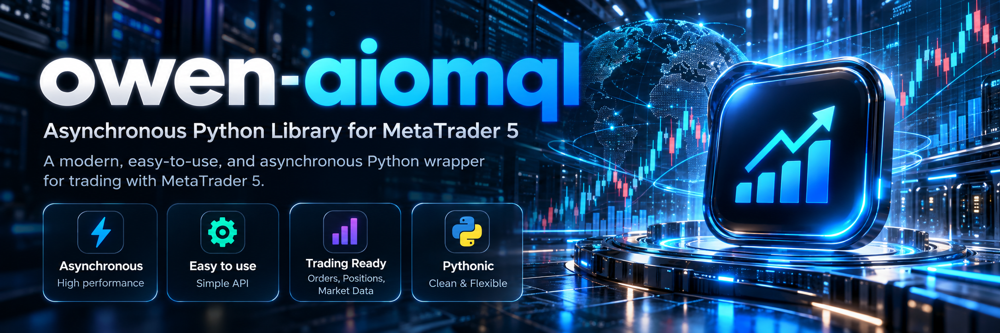

<p align="center">
  
</p>

<h1 align="center">owen-aiomql</h1>

<p align="center">
  <strong>Asynchronous Python Library for MetaTrader 5 and Algorithmic Trading</strong>
</p>

<p align="center">
  <a href="pyproject.toml">= 3.13"></a>
  <a href="LICENSE"></a>
  <a href="https://github.com/DQuooc/owen-aiomql/stargazers"></a>
  <a href="https://github.com/DQuooc/owen-aiomql/issues"></a>
</p>

## Overview

**owen-aiomql** provides an asynchronous interface to MetaTrader 5 and a framework for building algorithmic trading bots. It combines market-data access, reusable strategies, order execution, position management, trading sessions, and risk and money management.

The repository extends the upstream [aiomql](https://github.com/Ichinga-Samuel/aiomql) project. Its Python distribution and import package remain **`aiomql`**. Use the low-level MetaTrader interface directly, or compose symbols, traders, and strategies into a bot.

## Key Features

- **MetaTrader 5 interfaces** — asynchronous terminal calls, plus `MetaTraderSync` and selected synchronous trading components.
- **Bot orchestration** — run strategies across instruments with thread-pool execution, coroutine tasks, and independent bots through `Bot.process_pool()`.
- **Reusable strategies** — implement `Strategy.trade()` with configurable parameters and a session-aware execution loop.
- **Market data** — retrieve symbol information, candles, ticks, market depth, and trading history.
- **Orders and positions** — check and send orders, estimate margin and profit, query positions, and close trades.
- **Risk and money management** — `RAM` provides risk amounts, risk-to-reward settings, and position-limit checks for use in trading logic.
- **Trading sessions and tracking** — schedule trading in UTC windows, track strategy state, and attach position callbacks such as profit exits and take-profit extensions.
- **Trade records** — save results to CSV, JSON, or SQLite; `aiomql.ledger` provides explicit deal-history ingestion and account-scoped SQLite storage.
- **Technical analysis** — pandas-backed candles expose bundled pandas-ta-classic indicators with optional TA-Lib support.
- **Configuration and extensions** — share JSON or programmatic settings through `Config`, and build on `ForexSymbol`, `SimpleTrader`, `ScalpTrader`, and other contrib components.

## Requirements

- **Python 3.13 or later**, as declared in `pyproject.toml`.
- **64-bit Windows** for the native `MetaTrader5` Python dependency; the repository lockfile contains Windows x86-64 wheels for it.
- A locally installed **MetaTrader 5 desktop terminal** and a broker trading account.
- Terminal permissions that allow Python trading when running order-execution examples.

See the official [MetaTrader 5 Python integration guide](https://www.mql5.com/en/docs/python_metatrader5) for terminal integration details.

## Installation

Install this repository from source in a virtual environment:

```powershell
git clone https://github.com/DQuooc/owen-aiomql.git
cd owen-aiomql
python -m venv .venv
.\.venv\Scripts\Activate.ps1
python -m pip install --upgrade pip
python -m pip install .
```

The installed distribution is named `aiomql`. Source installation selects the code in this repository.

Optional extras declared in `pyproject.toml` can be installed from the same checkout:

```powershell
# TA-Lib indicators
python -m pip install ".[talib]"

# Cython, Numba, and tqdm
python -m pip install ".[optional]"

# Both sets of optional dependencies
python -m pip install ".[all]"
```

## Quick Start

### Configuration

Create `aiomql.json` in the directory from which you run your application:

```json
{
  "login": 12345678,
  "password": "your_password",
  "server": "YourBroker-Demo"
}
```

Alternatively, configure the shared `Config` instance before constructing trading components:

```python
from aiomql import Config

config = Config(
    login=12345678,
    password="your_password",
    server="YourBroker-Demo",
)
```

Programmatic values override file settings. Set `path` to your terminal executable if needed, and use `root` or `config_file` to select a different configuration location. Keep account credentials out of version control.

### MetaTrader Interface

With configuration in place, use the asynchronous interface to read account and symbol information:

```python
import asyncio

from aiomql import MetaTrader


async def main():
    async with MetaTrader() as mt5:
        account = await mt5.account_info()
        if account is None:
            raise RuntimeError(f"Unable to read account information: {mt5.error}")
        print(account)

        symbols = await mt5.symbols_get()
        print(f"{len(symbols or ())} symbols available")


if __name__ == "__main__":
    asyncio.run(main())
```

The context manager initializes the terminal, attempts login using `Config`, and shuts down the connection on exit.

## Building a Trading Bot

### 1. Define a Strategy

Subclass `Strategy` and implement one trading iteration in `trade()`. The framework calls it repeatedly while the strategy is running and checks its sessions before each iteration. Entries in `parameters` are accessible as attributes and can be overridden with `params`.

Save this example as `ema_crossover.py`. It checks the last two completed candles for an EMA crossover and delegates execution to `ScalpTrader`:

```python
from aiomql import (
    ForexSymbol, OrderType, ScalpTrader, Sessions, Strategy, TimeFrame, Tracker,
)


class EMAXOver(Strategy):
    parameters = {
        "timeframe": TimeFrame.H1,
        "count": 200,
        "fast_ema": 20,
        "slow_ema": 50,
        "interval": TimeFrame.M15,
    }

    def __init__(self, *, symbol: ForexSymbol, params=None, sessions: Sessions = None):
        super().__init__(symbol=symbol, params=params, sessions=sessions)
        self.trader = ScalpTrader(symbol=symbol)
        self.tracker = Tracker(snooze=self.interval.seconds)

    async def trade(self):
        candles = await self.symbol.copy_rates_from_pos(
            timeframe=self.timeframe, count=self.count, start_position=1,
        )
        if len(candles) < max(self.fast_ema, self.slow_ema) + 2:
            await self.sleep(secs=self.interval.seconds)
            return

        fast = candles.ta.ema(length=self.fast_ema, talib=False)
        slow = candles.ta.ema(length=self.slow_ema, talib=False)
        direction = None
        if fast.iloc[-2] <= slow.iloc[-2] and fast.iloc[-1] > slow.iloc[-1]:
            direction = OrderType.BUY
        elif fast.iloc[-2] >= slow.iloc[-2] and fast.iloc[-1] < slow.iloc[-1]:
            direction = OrderType.SELL
        self.tracker.update(order_type=direction)

        if self.tracker.order_type is None:
            await self.sleep(secs=self.interval.seconds)
            return

        await self.trader.place_trade(
            order_type=self.tracker.order_type, parameters=self.parameters,
        )
        await self.delay(secs=self.timeframe.seconds)
```

This example uses the bundled EMA implementation without requiring TA-Lib. `ScalpTrader` defaults to the symbol's minimum volume and places orders without stop-loss or take-profit levels. Use a demo account for the tutorial; adapt execution and position management before applying your own trading rules. `SimpleTrader` accepts a stop-loss price, and custom `Trader` subclasses can use `RAM` for sizing.

### 2. Run the Strategy with a Bot

Save this as `bot.py` alongside `ema_crossover.py`. Use your broker's exact symbol names:

```python
import logging

from aiomql import Bot, ForexSymbol
from ema_crossover import EMAXOver


def main():
    logging.basicConfig(level=logging.INFO)
    symbols = [ForexSymbol(name=name) for name in ("EURUSD", "GBPUSD", "USDJPY")]
    strategies = [EMAXOver(symbol=symbol) for symbol in symbols]

    bot = Bot()
    bot.add_strategies(strategies=strategies)
    bot.execute()


if __name__ == "__main__":
    main()
```

Run it with `python bot.py`. `Bot.execute()` initializes the terminal and symbols, then runs the registered strategies through its executor until shutdown.

To run an optional position tracker, register its coroutine before `bot.execute()`:

```python
from aiomql import OpenPositionsTracker

tracker = OpenPositionsTracker(autocommit=True)
bot.add_coroutine(coroutine=tracker.track, on_separate_thread=True)
```

The tracker processes `OpenPosition` objects registered in shared state; starting it alone does not attach tracking rules to every account position. See the [tracking APIs](docs/contrib/trackers/open_position.md) for registration and callbacks.

`await bot.start()` is also available for asynchronous initialization. It calls the same blocking executor afterward, so it occupies the calling event loop while the bot runs.

## Trading Sessions

Pass `Sessions` to a strategy to limit trading to selected windows. Session checks use **UTC**; the labels below are illustrative fixed windows and do not adjust for daylight saving time.

```python
from datetime import time

from aiomql import ForexSymbol, Session, Sessions
from ema_crossover import EMAXOver

london = Session(name="London", start=time(8, 0), end=time(16, 0))
new_york = Session(name="New York", start=time(13, 0), end=time(21, 0))
sessions = Sessions(sessions=[london, new_york])

strategy = EMAXOver(symbol=ForexSymbol(name="EURUSD"), sessions=sessions)
```

Sessions can also run configured start/end actions, including custom callbacks. See the [session reference](docs/lib/sessions.md) for details.

## Concurrent and Multi-process Execution

Within a bot, the executor runs strategies in worker threads, each asynchronous strategy using its own event loop. `Bot.add_coroutine()` and `Bot.add_function()` register additional work.

For independent bots, `Bot.process_pool()` maps module-level callables to keyword-argument dictionaries. Keep the process-pool call inside a main guard on Windows:

```python
from aiomql import Bot, ForexSymbol
from ema_crossover import EMAXOver


def run_bot(*, symbol_name: str):
    bot = Bot()
    bot.add_strategy(strategy=EMAXOver(symbol=ForexSymbol(name=symbol_name)))
    bot.execute()


def run_forex():
    run_bot(symbol_name="EURUSD")


def run_crypto():
    run_bot(symbol_name="BTCUSD")


if __name__ == "__main__":
    Bot.process_pool(
        processes={run_forex: {}, run_crypto: {}},
        num_workers=2,
    )
```

Each process initializes its own configuration and terminal connection. This helper schedules processes; configure account and terminal settings inside each worker when they differ.

## Project Structure

```text
src/aiomql/
├── __init__.py            # Public core, lib, contrib, and utility exports
├── core/                  # Terminal integration and shared infrastructure
│   ├── config.py          # JSON and programmatic configuration
│   ├── meta_trader.py     # Asynchronous MetaTrader interface
│   ├── volume.py          # Volume validation and rounding
│   ├── db.py              # SQLite persistence helpers
│   └── sync/              # Synchronous MetaTrader interface
├── lib/                   # Trading framework
│   ├── bot.py             # Bot startup and process pool
│   ├── executor.py        # Thread and coroutine execution
│   ├── strategy.py        # Strategy lifecycle and trade loop
│   ├── symbol.py          # Instruments and market data
│   ├── candle.py          # Candles and indicator access
│   ├── order.py           # Order checks and submission
│   ├── trader.py          # Execution and sizing helpers
│   ├── positions.py       # Position queries and closing
│   ├── ram.py             # Risk and money management
│   ├── sessions.py        # Session windows and actions
│   ├── result.py          # CSV, JSON, and SQLite result recording
│   └── sync/              # Selected synchronous trading components
├── contrib/               # Strategies, symbols, traders, and trackers
├── ledger/                # Deal normalization, ingestion, and SQLite storage
├── ta_libs/               # Bundled pandas-ta-classic implementation
└── utils/                 # Decorators, price helpers, and process pools
```

## API Documentation

Start with the [API Reference](docs/toc.md) for core, trading, contrib, and utility modules. The [tutorial](docs/tutorial.md), [examples](examples/), and [execution-flow overview](docs/code-reading/01-execution-flow-overview.md) provide additional usage and architecture context. Check source signatures when adapting examples.

## Testing

The repository separates offline execution/ledger tests from terminal-connected pytest tests.

### Offline Tests

From the repository root, run the standard-library suite with fake SDK dependencies:

```powershell
python -B -m unittest discover -s tests/offline -p 'test_*.py' -v
```

This command limits discovery to `tests/offline` and avoids the live pytest fixtures. See the [offline test guide](tests/offline/README.md).

### Terminal-connected Tests

Development dependencies, including `pytest` and `pytest-asyncio`, are declared in the `dev` dependency group. From the repository root, install the project in editable mode and install that group with [pip 25.1 or later](https://pip.pypa.io/en/stable/user_guide/#dependency-groups):

```powershell
python -m pip install -e .
python -m pip install --group dev
```

Configure `aiomql.json` and a MetaTrader 5 terminal connected to a dedicated demo account before running:

```powershell
python -m pytest -c tests/pytest.ini tests/live
```

**Live tests can place trades, and their cleanup closes all open positions on the connected account.** Review `tests/live/conftest.py` before running them. Unrestricted `pytest tests` also discovers these fixtures.

## Contributing

Contributions, bug reports, documentation improvements, and pull requests are welcome. For significant changes, please open an [issue](https://github.com/DQuooc/owen-aiomql/issues) first to discuss the proposed direction.

Submit contributions to [DQuooc/owen-aiomql](https://github.com/DQuooc/owen-aiomql) and follow the [Code of Conduct](CODE_OF_CONDUCT.md). This project builds on aiomql by Ichinga Samuel; upstream attribution and copyright are retained in the [license](LICENSE).

## License

[MIT](LICENSE)
